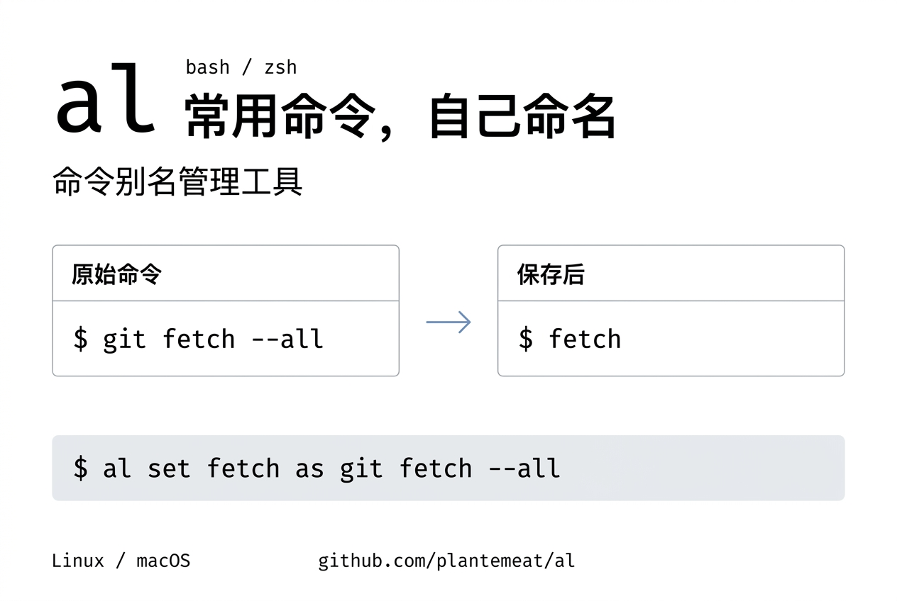
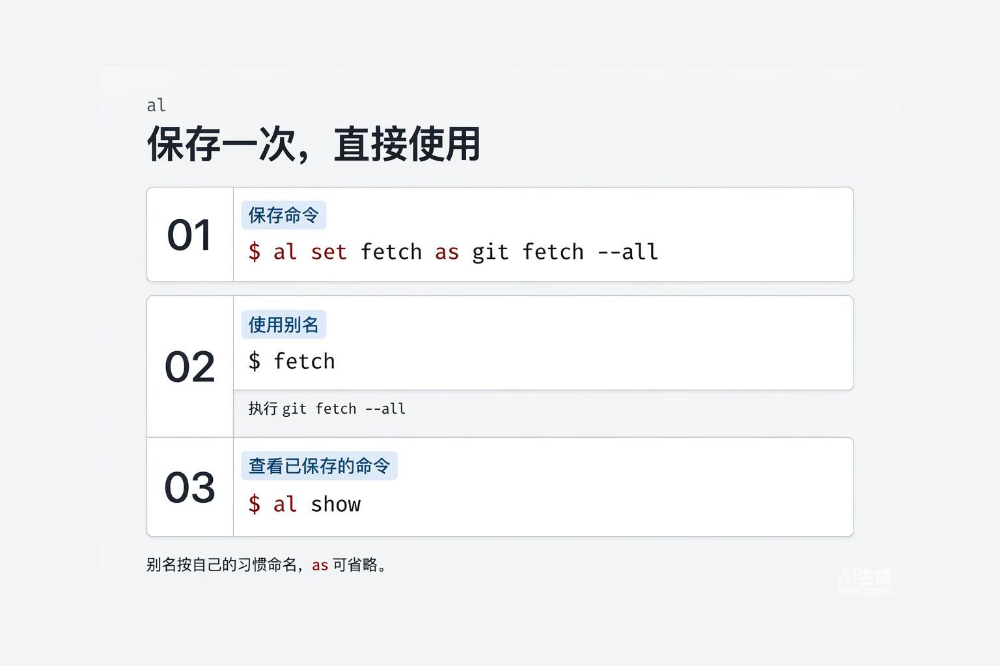

# al



一个用于 bash / zsh 的命令别名管理工具，支持 Linux 和 macOS。

介绍页：https://plantemeat.github.io/al/

SSH 登录、查看日志、运行项目脚本，常用命令总要反复输入。长命令不好记，翻历史记录也费事；用 `alias` 保存，又要手动维护 `.bashrc` 或 `.zshrc`。

比如，在 Git 仓库里获取远程更新，经常要输入 `git fetch --all`。用 `al` 保存一次，以后输入 `fetch` 就能执行：

```bash
al set fetch as git fetch --all
fetch  # 执行 git fetch --all
```

名字由你按自己的习惯取：可以叫 `fetch`，也可以叫 `gf`，只要不与保留名称或已有命令冲突。想看看自己保存过哪些命令，运行 `al show` 即可。

`al` 保存的别名新开终端也能用，不需要逐条修改 shell 配置。临时命令可以设置有效期，也支持删除、清理和导入导出。

## 安装

```bash
curl -fsSL https://raw.githubusercontent.com/plantemeat/al/main/install.sh | bash
exec "$SHELL"
```

如果 GitHub 下载较慢，可以通过第三方镜像安装：

```bash
curl -fsSL https://ghfast.top/https://raw.githubusercontent.com/plantemeat/al/main/install.sh \
  | AL_RAW_BASE=https://ghfast.top/https://raw.githubusercontent.com/plantemeat/al/main bash
exec "$SHELL"
```

安装文件和别名数据默认放在 `~/.al/`，安装脚本会在 `.bashrc` / `.zshrc` 中添加加载配置。

工具用 shell 编写，依赖系统常见命令；在线安装需要 `curl` 或 `wget`。

## 基本用法



### 保存命令

格式如下，`as` 可以省略：


```bash
# 保存命令；使用同名别名会覆盖原配置
al set sh12 as ssh server12
sh12 -p 2222  # 追加参数

# 包含管道、重定向或多步操作时，用引号包住整条命令
al set logs as 'tail -f /data/reth.log | grep -i error'
logs

# 临时别名，设置 7 天有效期；不指定 -t 则不过期
al set -t 7d logs as 'tail -f /data/reth.log | grep -i error'
```

### 查看与清理

```bash
al help                        # 查看完整用法
al show                        # 查看命令、最近使用时间、有效期和状态
al show ssh                    # 按名称或命令内容查找
al unset sh12                  # 删除别名

al clean --unused 90d -n        # 预览过期或 90 天未使用的别名
al clean --unused 90d           # 确认后清理
```

通过 `al` 修改别名后，当前终端立即更新；其他已打开的终端需要重新加载。

有效期在重新加载或清理时生效，不会在到期瞬间刷新当前终端。启动终端时也会定期静默清理过期别名，最多每天一次。

## 其他命令

| 命令 | 说明 |
| --- | --- |
| `al export > aliases.tsv` | 导出别名，便于备份或迁移 |
| `al import aliases.tsv` | 合并导入，同名别名会被覆盖 |
| `al update` | 从记录的安装源更新工具 |
| `al help` | 查看完整用法 |

数据保存在 `~/.al/aliases.tsv`。

`al show` 默认将 30 天未使用的别名标记为 `stale`，仅提示，不会因此自动删除；可通过 `AL_STALE_DAYS` 调整天数。

## 注意事项

- 别名只能包含字母、数字、`_` 和 `-`，不能以数字或 `-` 开头；`cd`、`ssh`、`sudo` 等保留名称不能使用。
- 默认拒绝新增与已有命令重名的别名，可用 `al set -f` 强制覆盖非保留名称。
- 保存的命令通过 `eval` 执行。只导入可信的别名文件，避免执行不明命令。

## 卸载

在仓库目录执行，保留别名数据：

```bash
bash install.sh --uninstall
```

追加 `--purge` 会同时删除安装目录及别名数据。卸载后重新打开终端。

## 开发

在临时 HOME 中测试 bash / zsh：

```bash
bash tests/run.sh
```

## 许可证

MIT License
